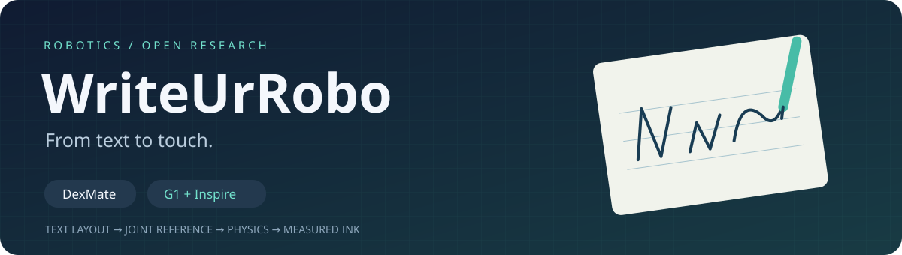
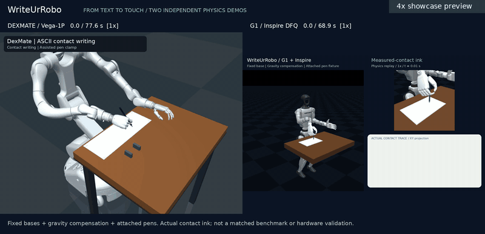
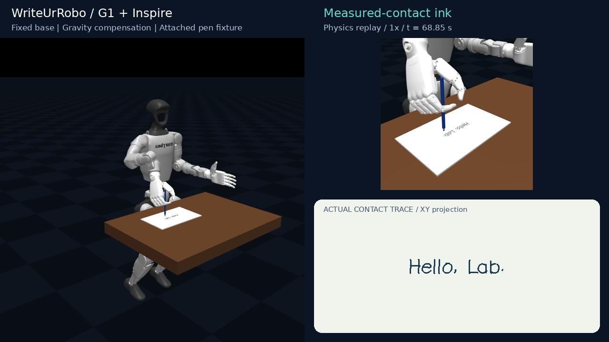
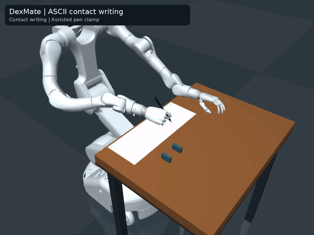
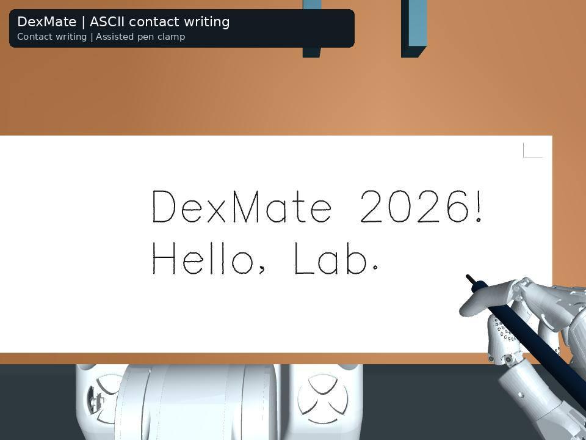
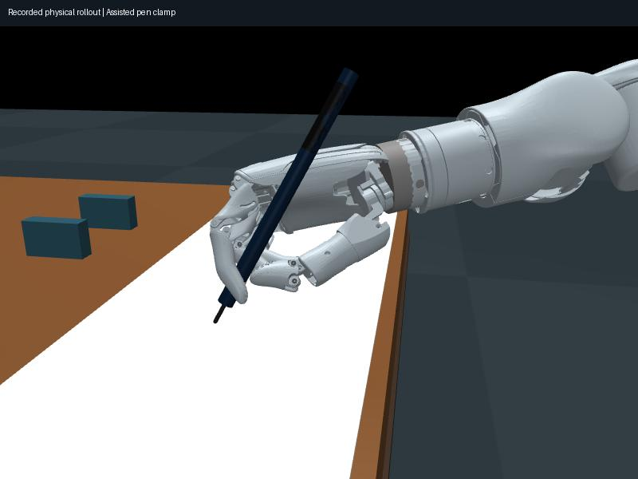
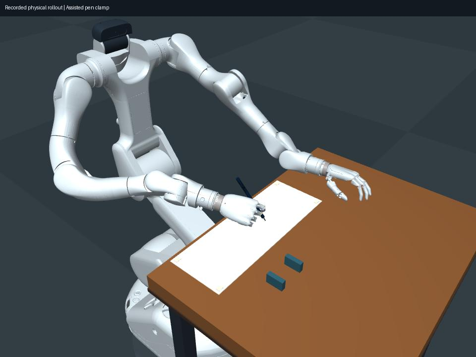

# WriteUrRobo

<p align="center"></p>

**Two robots. One idea: turn text into measured contact, not just an animation.**

[](https://github.com/MrAmazing-h/WriteUrRobo/actions/workflows/ci.yml)
[](LICENSE)
[](pyproject.toml)

<p align="center"><a href="https://github.com/MrAmazing-h/WriteUrRobo/releases/download/v0.3.0/writeurrobo_showcase.mp4"></a></p>
<p align="center">4× preview · <a href="https://github.com/MrAmazing-h/WriteUrRobo/releases/download/v0.3.0/writeurrobo_showcase.mp4">Original-speed dual showcase</a> · <a href="https://github.com/MrAmazing-h/WriteUrRobo/releases/download/v0.3.0/g1_contact_writing.mp4">G1 full video</a> · <a href="https://github.com/MrAmazing-h/WriteUrRobo/releases/download/v0.3.0/writeurrobo_g1_contact_record_v030.zip">G1 recorded states + video</a></p>

WriteUrRobo brings **DexMate Vega-1P** and **Unitree G1 + Inspire hands** into a reproducible ASCII writing showcase. Both use fixed-base, gravity-compensated simulation with an attached compliant-nib pen. Ink is reconstructed from actual nib–paper contacts, not painted from the intended letters.

| | DexMate Vega-1P | G1 + Inspire |
| :--- | :--- | :--- |
| Controller | Tip-position and normal-force feedback | Position servos + bounded Cartesian integral correction |
| Pen | Rigid attachment, compliant nib | Rigid fixture, compliant nib |
| Model | Dexmate official assets / calibrated station | Pinned Unitree revision / DFQ Inspire hands |
| Reproduce | [DexMate instructions](#run-your-own-text) | [G1 method and commands](docs/G1_WRITING.md) |

**Research scope, not a hardware claim:** neither demo proves autonomous grasping, safe pen pressure, collision-free execution or unsupported standing balance. The controllers and stations differ; this is a showcase, not a controlled robot benchmark. Original DexMate commands and releases remain available.

## G1 contact-writing result

<p align="center"></p>

The complete G1 `Hello, Lab.` run lasts **68.87 s**: mean pen-down XY error **0.955 mm**, P95 **1.673 mm**, contact fraction **95.08%**, peak recorded nib force **0.396 N**. The tracking/contact checks pass for this example only. Contact during 440 nominal pen-up samples is retained in the ink. Enabled-contact overlap remains, including a 5.20 mm thumb/fixture mesh contact; these are not collision-clearance or hardware-safety results. [Metrics](results/g1/metrics.json) · [Checks and scope](results/g1/writing_checks.json).

## G1 quick start

```bash
git clone https://github.com/MrAmazing-h/WriteUrRobo.git
cd WriteUrRobo
python -m venv .venv
source .venv/bin/activate
pip install -e '.[dev]'
g1-fetch-writing-model --output external/g1
g1-contact-write --model-dir external/g1 --text "Hello, Lab." --output outputs/g1_hello
MUJOCO_GL=egl g1-render-writing --output outputs/g1_hello
```

The distribution/import name stays `dexmate-writing` / `dexmate_writing` for compatibility. G1 adds independent commands without changing the original controller. See [station assumptions, data schema and limitations](docs/G1_WRITING.md).

## DexMate showcase

<p align="center"><a href="https://github.com/MrAmazing-h/dexmate-writing/releases/download/v0.2.0/ascii_contact_writing.mp4"></a></p>
<p align="center">4× preview · <a href="https://github.com/MrAmazing-h/dexmate-writing/releases/download/v0.2.0/ascii_contact_writing.mp4">Watch / download the full 77.58-second video at original speed</a></p>
<p align="center"></p>

### DexMate contact-writing pipeline (v0.2.0)

The original release animated a fixed Chinese phrase. The new pipeline accepts printable ASCII letters, numbers, punctuation and explicit line breaks, wraps and scales the text, generates a smooth joint reference, and executes it with MuJoCo physics. Pen-tip position and normal-force feedback correct the reference while the left hand maintains contact with the table. Ink comes from recorded nib–paper contacts, including unintended pen-up contacts, rather than painting the planned font paths.

**Scope:** the pen remains rigidly attached to the right hand with a passive compliant nib. The base is fixed and the robot links use gravity compensation. This is contact-writing simulation, not friction-only grasping, autonomous pickup-to-writing, tactile grasp adaptation, RL, or hardware validation. Inherited collision exclusions remain, and impact-force peaks are unresolved.

## Demonstrations

| Example | Full video | Result |
| :--- | :--- | :--- |
| Single-line `Yuxiong Lab` | [45.29 s, original speed](https://github.com/MrAmazing-h/dexmate-writing/releases/download/v0.2.0/yuxiong_lab_contact.mp4) | [Overhead image](assets/contact_single_line.jpg) |
| Two-line `DexMate 2026!` / `Hello, Lab.` | [77.58 s, original speed](https://github.com/MrAmazing-h/dexmate-writing/releases/download/v0.2.0/ascii_contact_writing.mp4) | [Overhead image](assets/contact_overhead.jpg) |
| Original Chinese phrase, kinematic | [v0.1.0 video](https://github.com/MrAmazing-h/dexmate-writing/releases/download/v0.1.0/dexmate_writes.mp4) | [Legacy method and commands](docs/KINEMATIC_DEMO.md) |

<p align="center"></p>

The single-line example uses the earlier calibrated letter paths; the configurable Hershey layout was evaluated separately on the two-line example. The photos show archived physical-rollout states. They do not establish autonomous grasping.

## Run your own text

Linux and Python 3.11 are the locally tested setup. Use a new output directory for each run. Rendering needs a working OpenGL backend; FFmpeg is supplied by `imageio-ffmpeg`.

```bash
git clone https://github.com/MrAmazing-h/WriteUrRobo.git
cd WriteUrRobo
python -m venv .venv
source .venv/bin/activate
pip install -e '.[dev]'

# Layout only: no robot model, simulator rollout, or GPU required.
dexmate-contact-write --text "Hello 123!" --output outputs/layout --layout-only

# Fetch the calibrated station (about 14 MB, SHA-256 checked).
dexmate-fetch-contact-station --output external
printf 'DexMate 2026!\nHello, Lab.\n' > text.txt
MUJOCO_GL=egl dexmate-contact-write --text-file text.txt --output outputs/contact
```

`--station-dir` selects another copy of the same calibrated station; it is not an adapter for arbitrary robots. `--max-cap-mm 25` reproduces the recorded two-line layout setting. `--no-render` runs planning, physics and evaluation without video; `MUJOCO_GL=osmesa` can be used where OSMesa is installed. Each stage writes a log before reporting completion. The model is shared through a relative symlink, so keep the station directory in place.

All 95 printable ASCII characters are represented by Hershey `futural`; spaces have no strokes. Chinese text is rejected by this interface. Word wrapping, long-word splitting and scale fitting use a calibrated 280 × 70 mm area, with a minimum capital height of 10 mm. Text that does not fit is rejected. Layout support for a character does not certify its physical execution.

## Recorded contact-writing results

| Measurement | Single line | Two lines |
| :--- | ---: | ---: |
| Mean pen-down XY tracking error | 0.264 mm | 0.257 mm |
| P95 pen-down XY tracking error | 0.505 mm | 0.503 mm |
| Stroke coverage within 1 mm of measured ink | 100.00% | 100.00% |
| Pen-down contact coverage at 100 Hz | 99.699% | 99.939% |
| Maximum enabled-contact penetration, all 2 kHz substeps | 0.603 mm | 0.725 mm |
| Peak individual recorded nib contact force | 12.826 N | 21.270 N |

These are two specific simulation demonstrations, not a success rate over random texts. The force peaks are unresolved impact transients; passing geometric acceptance does **not** establish safe pen pressure. Coverage is the nearest same-stroke physical ink distance from a densely sampled reference path; it differs from time-aligned tracking error. The old kinematic IK error and the new physical-rollout error are not an apples-to-apples improvement comparison.

See [full two-line metrics](results/contact/metrics.json), [acceptance](results/contact/acceptance.json), [all-substep collision audit](results/contact/substep_collision_audit.json), [two-example CSV](results/contact/showcase_metrics.csv), and [method, feedback equations and reproduction scope](docs/CONTACT_WRITING.md).

## Outputs

- `layout.json` / `layout_preview.png`: planned layout only.
- `reference.npz`: 100 Hz joint/pen-tip reference, stroke IDs and pen-down mask.
- `rollout.npz`: actual simulated joint states, contact forces and ink samples, plus the reference index (which can pause while contact is established).
- `metrics.json`, `substep_collision_audit.json`, `acceptance.json`: evaluated geometric criteria and limitations.
- `videos/text_contact_writing.mp4` / `videos/final_overhead.jpg`: physical-state replay with measured-contact ink.

[Release v0.2.0](https://github.com/MrAmazing-h/dexmate-writing/releases/tag/v0.2.0) includes videos, the calibrated station, and a compact recorded reference/rollout bundle. These NPZ files are simulation records, not certified deployment commands. The v0.1.0 Chinese example and `dexmate-writing` CLI remain available unchanged.

## Development and attribution

```bash
ruff check .
ruff format --check .
pytest -q
python -m build
```

Code: MIT. Robot assets: Dexmate Inc., Apache 2.0. ASCII layout: Hershey-Fonts 2.1.0 / Hershey vector fonts. Legacy Chinese stroke data: Hanzi Writer Data 2.0.1, with its bundled Arphic license. See [third-party notices](THIRD_PARTY_NOTICES.md), [contributing](CONTRIBUTING.md), and [citation](CITATION.cff).

Related project: [DanceUrRobo](https://github.com/MrAmazing-h/DanceUrRobo) — video-to-robot dance demonstrations.
