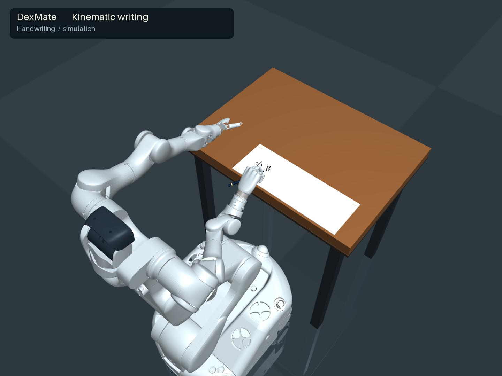
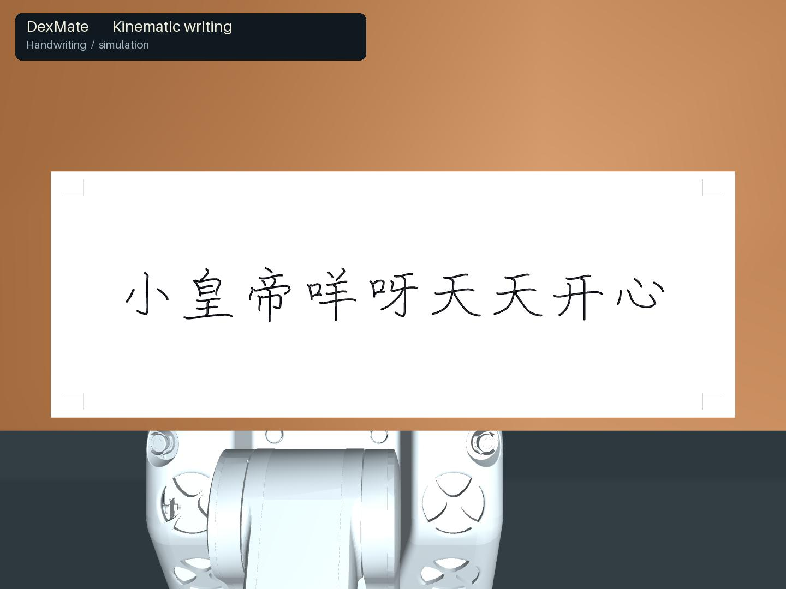

# DexMate Writing

**Chinese handwriting with Vega-1P/F5D6: stroke paths → pen-tip IK → robot motion → visible ink.**

[](https://github.com/MrAmazing-h/dexmate-writing/actions/workflows/ci.yml)
[](LICENSE)
[](pyproject.toml)

<p align="center"></p>
<p align="center"></p>

[Watch / download the full demonstration](https://github.com/MrAmazing-h/dexmate-writing/releases/download/v0.1.0/dexmate_writes.mp4) · [Release assets](https://github.com/MrAmazing-h/dexmate-writing/releases/tag/v0.1.0) · [Method](docs/METHOD.md) · [Reproduction](docs/REPRODUCIBILITY.md)

The demonstration writes **小皇帝咩呀天天开心** in one line: nine characters, 53 strokes. The pen begins in the right hand. A custom differential IK solver follows stroke medians using a fixed hand-to-pen transform. Ink follows the actual forward-kinematic pen tip during pen-down segments and is projected onto the paper. After retraction, the camera transitions to a vertical overhead view.

**Scope:** a kinematic animation, with a rigid pen attachment and preset fingers. No RL, pen pickup, dynamic grasp, contact-force control, or hardware execution is demonstrated. The NPZ is a pose reference, not a deployable controller.

## Quick start

Linux, Python 3.11 recommended. Python 3.12 is covered by CI; macOS and Windows are not validated. FFmpeg is supplied by `imageio-ffmpeg`; rendering requires a working OpenGL backend.

```bash
git clone https://github.com/MrAmazing-h/dexmate-writing.git
cd dexmate-writing
python -m venv .venv
source .venv/bin/activate
pip install -e '.[dev]'
dexmate-fetch-model --output external
dexmate-writing build --model-dir external/vega_1p_f5d6 --output outputs/writing
dexmate-writing solve --output outputs/writing
dexmate-writing validate --output outputs/writing
MUJOCO_GL=egl dexmate-writing render --output outputs/writing
```

On a CPU-only Linux host with OSMesa installed, use `MUJOCO_GL=osmesa`. For a desktop, use the default GLFW backend. Inspect six still frames quickly with `dexmate-writing preview --output outputs/writing`. Rendering does not call `mj_step`; every pose is evaluated by `mj_forward`.

The model download is a 14.2 MB ZIP with the exact converted MJCF, URDF and referenced meshes, SHA-256 checked by the downloader. The conversion retains the upstream Apache license; it is separate from the code license. No other project checkout or simulator training environment is required.

## Recorded demonstration

| Quantity | Value |
| :--- | ---: |
| Robot trajectory | 3,654 frames at 60 Hz |
| Video duration | 60.9 s |
| Strokes / characters | 53 / 9 |
| Mean pen-down position error | 0.00184 mm |
| Maximum pen-down position error | 0.550 mm |
| Maximum position error over all frames | 5.323 mm |
| Joint position limit violations | 0 |

These are numerical IK/FK errors relative to the commanded pen-tip path, **not measured handwriting or hardware accuracy**. Travel frames are included in the all-frame maximum. See [recorded metrics](results/recorded_evaluation.json) and [release validation](results/release_validation.json).

## Outputs and layout

- `outputs/writing/writing_reference.npz`: qpos, 60 Hz timing, target/actual pen tip, pen-down mask, stroke/character IDs, model joint ordering, and camera timing.
- `outputs/writing/validation.json`: independently recomputed FK errors and joint-limit checks.
- `outputs/writing/videos/dexmate_writes.mp4`: full video; `final_overhead.jpg`: completed writing.
- `src/dexmate_writing/`: scene construction, trajectory generation, IK, rendering, validation and asset download.
- `examples/writing_reference.npz`: recorded robot trajectory for inspection and replay.
- `tests/`: packaged stroke coverage, timing, paper bounds and model-contract checks.

The fixed phrase and workspace constants live in `handwriting.py`. Changing text length, paper geometry or grip requires rechecking reachability, spacing and the validation gates. This release optimizes reproducibility of the demonstrated phrase rather than promising arbitrary text generation.

## Development and attribution

```bash
ruff check .
ruff format --check .
pytest -q
python -m build
```

Code: MIT. Robot assets: Dexmate Inc., Apache 2.0. Character medians: Hanzi Writer Data 2.0.1, derived from Make Me a Hanzi / Arphic fonts, under the bundled Arphic Public License. See [third-party notices](THIRD_PARTY_NOTICES.md), [contributing](CONTRIBUTING.md), and [software citation](CITATION.cff).

Related project: [DexMate Video Retargeting](https://github.com/MrAmazing-h/dexmate-video-retargeting).
